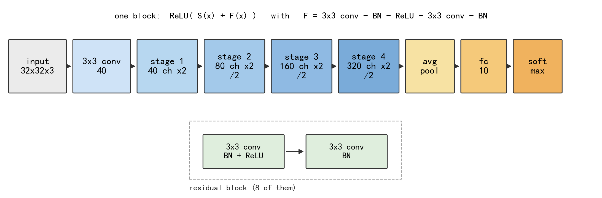

# Efficient ResNet for CIFAR-10 (under 5 million parameters)

Course project for the *Efficient ResNet Architecture Challenge*. Two ResNet-18
variants are implemented **from scratch** in PyTorch and trained on the
CIFAR-10 data of the competition. Each network has fewer than 5,000,000
trainable parameters, and no pretrained weights or external training data are
used anywhere.

| | |
|---|---|
| Team | `[Member 1] ([NetID 1]), [Member 2] ([NetID 2])` |
| Kaggle team name | `[Kaggle Team Name]` |
| Final leaderboard accuracy | **88.6%** (public leaderboard) |

## Results

Validation split: 5,000 of the 50,000 training images are held out (the same
split for every run, seed 42), 45,000 are used for training.

| Model | Params | Validation | CIFAR-10 test | CIFAR-10.1 | Leaderboard |
|-------|--------|-----------|---------------|------------|-------------|
| A — `resnet18_w40`, 150 epochs | 4,368,690 | 95.56% | 94.97% | 88.55% | 84.0% |
| B — `resnet18_w48`, 180 epochs, stronger augmentation | 4,664,330 | 95.32% | 95.50% | 89.30% | — |
| B + 6-view TTA | 4,664,330 | 95.68% | 95.96% | 90.30% | — |
| **A + B, 6 views each (submitted)** | 4,368,690 + 4,664,330 | **96.22%** | **96.53%** | **90.65%** | **88.6%** |

"CIFAR-10 test" is the official 10,000 image test set and "CIFAR-10.1" is the
2,000 image re-collected set of Recht et al. (2018); both were used **only for
evaluation**, never for training. The submitted file averages the class
probabilities of the two networks. Each network is below the parameter limit on
its own, so the third row is a valid single-model entry.

Ablation study behind model A (all at 60 epochs except the last row):

| Model | Epochs | Cutout + label smoothing | Params | Validation |
|-------|--------|--------------------------|--------|------------|
| `resnet18_w32` | 60 | no | 2,797,610 | 94.42% |
| `resnet18_w40` | 60 | no | 4,368,690 | 94.60% |
| `resnet18_w40` | 60 | yes | 4,368,690 | 94.86% |
| `resnet18_w40` | 150 | yes | 4,368,690 | 95.58% |

## Repository layout

```
src/model.py             the network: residual block, stages, parameter counter
src/dataset.py           reading the PNG files + all augmentation
                         (crop, flip, cutout, mixup, cutmix, colour jitter, noise)
src/train.py             training (SGD + warm-up + cosine, mixed precision)
src/evaluate.py          validation accuracy, confusion matrix, per-class table
src/predict.py           one checkpoint -> submission.csv
src/ensemble_predict.py  several checkpoints x test-time augmentation -> submission.csv
figures/                 the architecture diagram and the confusion matrix
data/                    the competition data (not included, see data/README.md)
```

## Setup

Python 3.10, PyTorch 2.5.1 with CUDA 12.1 was used. A GPU is strongly
recommended: model B takes about 100 minutes on an RTX 3060, and roughly six
hours on a CPU.

```bash
pip install -r requirements.txt          # see the file for the CUDA index URL
```

Put the competition data in `data/` exactly as described in
[`data/README.md`](data/README.md).

## Reproducing the results

```bash
# 1. model A: 150 epochs, about 50 minutes
python src/train.py --model resnet18_w40 --epochs 150 --batch-size 128 \
       --cutout 8 --label-smoothing 0.1 --out-dir runs/main

# 2. model B: 180 epochs, about 100 minutes
python src/train.py --model resnet18_w48 --epochs 180 --batch-size 96 \
       --cutout 8 --cutmix 1.0 --color-jitter 0.35 --noise 0.04 \
       --label-smoothing 0.1 --seed 1 --out-dir runs/robust_w48

# 3. validation accuracy, per-class accuracy and the confusion matrix
python src/evaluate.py --checkpoint runs/robust_w48/best.pt \
       --out-fig figures/confusion.png

# 4. the submitted file: average of the two networks, 6 views each
python src/ensemble_predict.py --checkpoints runs/main/best.pt \
       runs/robust_w48/best.pt --tta full --out data/submission.csv

# or a single network, if one model is enough
python src/predict.py --checkpoint runs/robust_w48/best.pt --out data/submission.csv
```

`train.py` prints the number of trainable parameters before the first epoch and
the validation accuracy of every epoch, so the 5,000,000 limit can be checked at
a glance. Every run writes `metrics.csv`, `summary.json`, `last.pt` and
`best.pt` into its `--out-dir`.

A one-epoch smoke test of the whole pipeline takes about a minute:

```bash
python src/train.py --model resnet18_w32 --epochs 1 --out-dir runs/smoke
```

## The network

`ResNetCIFAR` follows the ResNet-18 block diagram of the assignment:
`3x3 conv -> 4 stages x 2 residual blocks -> global average pool -> fc 10`.



The differences from the original ImageNet ResNet-18 are the ones that are
standard for 32x32 images:

| part | detail |
|------|--------|
| stem | one 3x3 convolution (stride 1), no 7x7 convolution and no max pool |
| stages | channels 40-80-160-320 (model B: 48-88-176-320), 2 blocks each |
| downsampling | stride 2 in the first block of stages 2, 3 and 4: 32 → 16 → 8 → 4 |
| skip connection | identity, or 1x1 convolution + BN when the shape changes |
| pooling | global average pooling |
| initialisation | He (Kaiming) normal for convolutions, BN weight 1 / bias 0 |
| bias | none in the convolutions, BN makes it redundant |

A residual block computes `ReLU(S(x) + F(x))` with
`F = 3x3 conv - BN - ReLU - 3x3 conv - BN`.

### Training settings of the submitted model (B)

| item | value |
|------|-------|
| optimiser | SGD, momentum 0.9, Nesterov |
| learning rate | 0.1, linear warm-up for 5 epochs, then cosine decay to 0 |
| weight decay | 5e-4 |
| batch size / epochs | 96 / 180 |
| loss | cross entropy with label smoothing 0.1 |
| augmentation | random crop (reflect pad 4), random flip, colour jitter 0.35, Gaussian noise 0.04, cutout 8x8, CutMix (alpha 1.0) |
| precision | float16 with loss scaling (`torch.amp`) |
| test-time augmentation | 6 views: image, mirror, ±1 px vertical shift of both |

## Why is the leaderboard score lower than the validation score?

The leaderboard images come from a **different collection** than the training
images, so the leaderboard measures accuracy under a distribution shift. Two
checks, run once against the official CIFAR-10 release:

- all 50,000 training images of this project are byte-for-byte identical to the
  official CIFAR-10 training images (same labels, 50,000 of 50,000);
- none of the 2,000 test images appears in the official CIFAR-10 test set, not
  even after a flip, a rotation or a transpose.

So the images we can label (validation split + official test set) overestimate
the leaderboard score. Model A gets 94.97% on the official test set and 88.55%
on CIFAR-10.1 with unchanged weights, and the stronger augmentation of model B
recovers about 0.8 point of that drop.

Three label-free adaptation methods were tried on CIFAR-10.1 before being
rejected; all of them were neutral or worse, so none of them is part of this
pipeline:

| method | CIFAR-10.1 |
|--------|------------|
| none (model A) | 88.55% |
| batch-norm statistics re-estimated on the new set | 87.20% |
| TENT entropy minimisation (BN scale and shift only) | 86.85% |
| pseudo-label self-training | 88.50% (0 labels changed) |

The lesson: a better augmentation recipe generalises better than test-time
tricks do, and only running both showed it.
